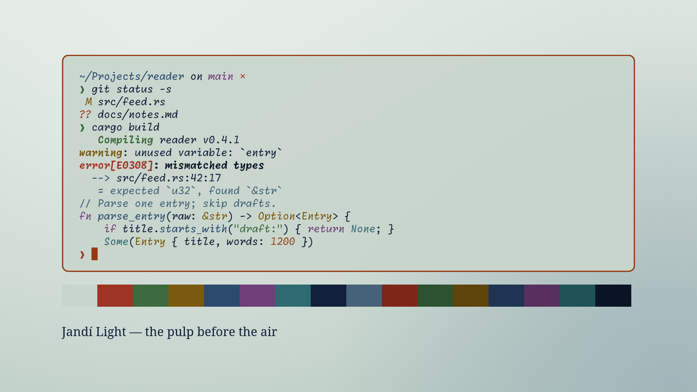

# Jandí Light — an Omarchy theme

Light. The fresh pulp, before the air turns it blue.



## Credits

**The palette is the work of Francisco Tarcizo Bomfim Júnior
([@franciscotbjr](https://github.com/franciscotbjr)), from the project
[jandi-colors](https://github.com/franciscotbjr/jandi-colors)** — eight tones
derived from the blue pigment of the jenipapo fruit (*Genipa americana*), the
ancestral paint of Brazil's indigenous peoples. Its eight structural tones
(Suco verde, Brisa, Oby, Jandí, Genipina, Nhandí, Yandí, Tinta de guerra) are
used here unchanged, under its MIT licence. The research and naming behind
them come from that project; read the [jandi-colors README](https://github.com/franciscotbjr/jandi-colors#readme)
for the chemistry of genipin and the Tupi roots of each name.

jandi-colors in turn credits the genipin research of UNICAMP/Lasefi (Maria
Isabel Neves, Monique Strieder, Maria Angela Meireles), Silveira Bueno's
*Vocabulário Tupi-Guarani*, and the Instituto Socioambiental's *Povos
Indígenas no Brasil*.

This theme only adapts that palette to Omarchy: it adds the terminal hues a
desktop needs and the generated backgrounds. It is not affiliated with or
endorsed by the palette's author.

## The idea

*Jandí* comes from the old Tupi *yandï'pawa*, "the fruit that serves to
paint". Jenipapo juice comes out of the green fruit almost clear and turns
blue-black on contact with air; the palette's eight tones are that oxidation,
step by step.

The background is **Suco verde**, the fresh pulp; text is **Yandí**, the ink it becomes. The urucum accent is deepened to stay legible in daylight. Oby, the Tupi blue, fades to 2.8:1 on this ground, so the muted tone steps one shade deeper in the same family.

Eight blues cover backgrounds, text and selection, but a terminal also needs
red, green and yellow. Rather than invent them, every added hue comes from the
same world as the pigment: urucum, the leaf and ripe fruit of the jenipapo
tree, and açaí.

## Install

```sh
omarchy theme install https://github.com/arnaudmatheus/omarchy-jandi-light-theme
```

Companion variant: [Jandí](https://github.com/arnaudmatheus/omarchy-jandi-theme).

## Palette

Contrast is the WCAG 2.x ratio against the theme's own background. Every
terminal colour clears 4:1.

| Role | Hex | Source | Contrast |
|---|---|---|---|
| accent | `#963A16` | urucum, deepened for light | 4.8:1 |
| background | `#C8D5CC` | Suco verde | — |
| foreground | `#11203A` | Yandí | 10.7:1 |
| muted | `#46627A` | between Oby and Genipina | 4.2:1 |
| red | `#9E3424` | deep urucum | 4.7:1 |
| orange | `#94481A` | urucum seed | 4.3:1 |
| yellow | `#7A5A10` | ripe pulp | 4.2:1 |
| green | `#3D6A3F` | jenipapo leaf | 4.2:1 |
| cyan | `#2E6A70` | deep Oby | 4.1:1 |
| blue | `#2C4A6E` | Genipina | 6.0:1 |
| magenta | `#6E3F78` | açaí | 5.2:1 |
| brown | `#6A4A28` | fruit skin | 5.3:1 |

Bright variants and the remaining background/foreground steps are in
[`colors.toml`](colors.toml), each annotated.

## Backgrounds

- `1-polpa`: the fresh Suco verde pulp, with Brisa blue creeping in from one corner as the air begins to oxidize it
- `2-oxidacao`: the full eight-tone ramp, juice to ink

Both are generated from the palette itself. They deliberately use no
indigenous body-painting patterns (*grafismos*): those designs belong to
specific peoples and are not ours to borrow.

## Licence

MIT — see [LICENSE](LICENSE). The palette's original copyright notice is kept
there, as its licence requires.
